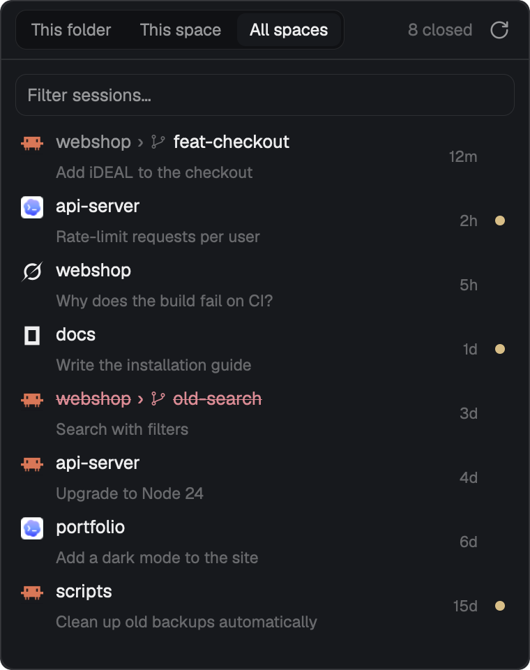
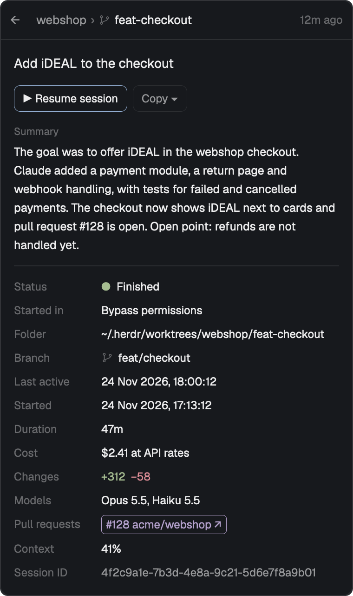
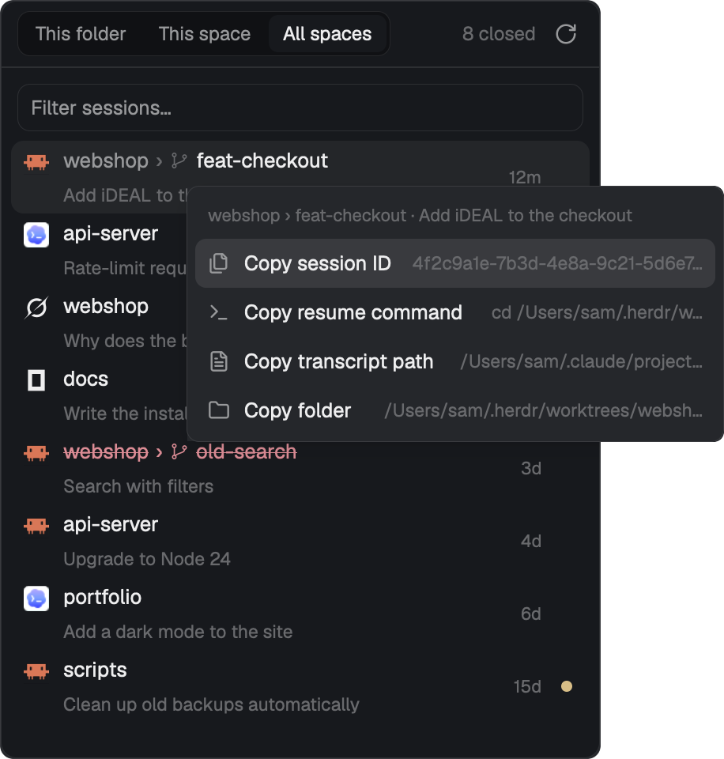

# Sessions panel for the Herdr desktop app

A panel for the [Herdr desktop app](https://github.com/herdrdev/herdr-app) (`herdr-app`) with all your closed agent sessions: Claude Code, Codex, Grok and OpenCode, in one list. You see at a glance what you were working on, how each session ended and what happened in it. One click takes you back to where you left off.



*The sessions in these screenshots are made up.*

> [!NOTE]
> This is a mod for the Herdr **desktop app** (`herdr-app`), not for Herdr in the terminal (`herdr`).

## What it does

- It lists your closed sessions, newest first. Sessions that are still open are left out.
- Each row shows where the session ran, what it was about and how it ended.
- A click opens a session with a summary and all its details.
- **Resume** continues a session in the right folder, in the same mode it started in.
- A right-click copies the session ID, the resume command, the transcript path or the folder.

## The list

At the top of the panel:

- **This folder**, **This space** and **All spaces** choose which sessions you see:
  - **This folder:** only the sessions from the folder of the terminal you're working in.
  - **This space** (the default): the sessions from the whole repository the space is in: its main folder and every worktree, as Herdr's sidebar groups them, including every folder inside them. A space outside a repository covers its folder and every folder inside it. For a space in your home folder, only the sessions from your home folder itself, since everything under it would be nearly every session.
  - **All spaces:** all of them.
- **The number** of closed sessions, with the **refresh button** to reload the list. While the panel is on screen, it also reloads by itself every minute.
- **Filter sessions…** searches the description, folder, branch and session ID.

Each row shows:

- **The agent's icon:** Claude Code, Codex, Grok or OpenCode.
- **Where the session ran:** the repo, followed after the › by the worktree or the name of your Herdr space, for example `webshop › feat-checkout`. A worktree gets a branch icon, as in Herdr's spaces sidebar.
- **Below it, what the session was about:** the title the agent gave it, or else your first message.
- **On the right, how long ago** you last worked in it (`12m`, `2h`, `1d`).
- **A yellow dot:** the session stopped mid-work. Your last message got no answer, you interrupted the agent, or it stopped in the middle of an action.
- **Red and struck through:** the session's folder no longer exists, for example because its worktree was removed. Such a session can't be resumed.

## Viewing a session

Click a row. The session opens in place of the list; **←** takes you back. Nothing happens to the session itself yet.



- **Summary** is a short summary of the whole session: the goal, what changed, the result and what's still open. If Claude Code saved a recap of its own, that is shown (headed **Recap**); otherwise Claude writes one (see [Privacy and cost](#privacy-and-cost)).
- **▶ Resume session** resumes the session (see below).
- **Copy ▾** opens the copy menu.
- Below that are the facts: the status, the mode the session started in, the folder, branch and Herdr space, when it started and was last active, how long the agent worked, the cost, the lines changed, the models, the pull requests (click to open them), the context use and the session ID. Whatever an agent doesn't record is left out, such as the cost of a Codex session.

## Resuming

**Resume session** opens the session in a new tab, in the Herdr space that holds the session's folder. If no space holds that folder, the panel creates one. The tab is named after the session's description.

| Agent | Resumed with |
|---|---|
| Claude Code | `claude --resume <id>`, plus the mode the session started in (see below) |
| Codex | `codex --no-daemon resume <id>` |
| Grok | `grok --resume <id>`, plus `--always-approve` if the session started with `--yolo` |
| OpenCode | `opencode --session <id>` |

A Claude Code session comes back in the mode it started in:

| Started in | Resumed with |
|---|---|
| Bypass permissions (`--dangerously-skip-permissions`) | `--dangerously-skip-permissions` |
| Auto | `--permission-mode auto` |
| Plan | `--permission-mode plan` |
| Anything else | no extra flag: Claude Code asks for permission again |

So you only continue without permission prompts if you started the session that way. Codex restores a session's permissions itself.

Before starting, the panel checks that the folder still exists and that the session isn't already open somewhere, so you never open a session twice.

## Copying

Right-click a row, or click **Copy ▾** in an open session.



- **Copy session ID** copies the session's ID.
- **Copy resume command** copies `cd <folder> && <resume command>`. Paste it into any terminal to resume the session there.
- **Copy transcript path** copies the path of the file in which the agent keeps the conversation. Handy for handing to another agent. OpenCode keeps everything in one database, so it has no file per session.
- **Copy folder** copies the session's folder.

The menu also works with the arrow keys and Enter; Esc closes it. A short notification shows what's on the clipboard.

## Supported agents

| Agent | Sessions read from | Open session recognized by |
|---|---|---|
| Claude Code | `~/.claude/projects` | Claude Code's own list in `~/.claude/sessions` |
| Codex | `~/.codex/sessions` | the transcript a running Codex holds open |
| Grok | `~/.grok/sessions` | Grok's own list, `~/.grok/active_sessions.json` |
| OpenCode | `~/.local/share/opencode/opencode.db` | the `opencode` programs that are running |

If you moved those folders with `CLAUDE_CONFIG_DIR`, `CODEX_HOME`, `GROK_HOME` or `XDG_DATA_HOME`, the panel follows them. Sub-agent sessions aren't listed, nor are archived OpenCode sessions.

Herdr knows more agents, such as Gemini, Copilot and Amp. They aren't in the list yet: every agent stores its sessions in its own way, so each one needs its own reader.

## Install

Before you install, know that this mod runs programs (`python3`, `git`, `ps`, `lsof`, `claude`), reads your agents' session files outside its own folder, and sends conversation text to Claude for summaries. [Privacy and cost](#privacy-and-cost) has the details.

### Ask an agent in Herdr

The agents in the Herdr desktop app know how to add a mod from GitHub. Ask one:

> Add the Herdr mod from https://github.com/inlet/herdr-sessions

### Or copy it yourself

1. Get the files and copy the mod folder into Herdr's mods folder:

   ```sh
   git clone https://github.com/inlet/herdr-sessions
   cp -R herdr-sessions/mods/sessions-history ~/.config/herdr-app/mods/
   ```

   Keep the name `sessions-history`: the panel uses it in its own paths. Don't overwrite an existing mod with that name.
2. Check that Herdr loads the mod:

   ```sh
   herdr-app check ~/.config/herdr-app/mods/sessions-history
   ```

3. Try it out in an overlay over the window (the same command again closes it):

   ```sh
   herdr-app do mod.open --name sessions-history
   ```

## Put it in your layout

The mod doesn't add itself to your layout. Either way below, the block that holds it must have the id `session-history-panel`: that's how the panel knows it's on screen. Only then does it reload itself every minute and check every ten seconds which sessions are open.

Herdr's own layouts and mods are read-only, so the steps below work on copies. If you already have your own layout or tab bar, use those instead.

### In the side panel, with a button in the tab bar

This puts **Agents** next to Files and Changes: a button in the tab bar opens the panel on the right. The easiest way is to ask an agent in Herdr:

> Add the sessions-history mod to the side panel of my layout, next to Files and Changes: a block with id `session-history-panel` in the `panel-body` stack, and an "Agents" button in the tab bar with the icon `mods/sessions-history/history.svg`.

To do it yourself:

1. Copy Herdr's layout and tab bar:

   ```sh
   herdr-app do layout.clone '{"name":"main","as":"my-layout"}'
   herdr-app do mod.clone '{"name":"tabs","as":"my-tabs"}'
   ```

2. In `~/.config/herdr-app/layouts/my-layout.json`, add this block to the children of the `panel-body` stack, and change the `tabs` block's content to `{ "mod": "my-tabs" }`:

   ```json
   { "id": "session-history-panel", "type": "block", "content": { "mod": "sessions-history" } }
   ```

3. In `~/.config/herdr-app/mods/my-tabs/main.js`, add the panel to the list of enabled panels, so the tab bar remembers it per space:

   ```js
   const enabled = [...(shared("workspace.panels") ?? ["files", "changes"]), "session-history-panel"];
   ```

   and add a button after the Changes button:

   ```js
   .child(panelButton("session-history-panel", "Agents", "mods/sessions-history/history.svg"))
   ```

### Or as a column of its own

Add this block to a copy of the layout (`herdr-app do layout.clone '{"name":"main","as":"my-layout"}'`), for example as the last child of the top `row`, so the panel sits on the right:

```json
{
  "id": "session-history-panel",
  "type": "block",
  "size": { "px": 360 },
  "min": 280,
  "content": { "mod": "sessions-history" }
}
```

Hide and show it with:

```sh
herdr-app do layout.toggle --id session-history-panel
```

## Update and remove

To update, copy the new `mods/sessions-history` folder over the old one. Your cache and summaries in `~/.config/herdr-app/data/sessions-history` stay.

To remove the mod, delete `~/.config/herdr-app/mods/sessions-history` and `~/.config/herdr-app/data/sessions-history`, and take the block (and the button, if you added one) out of your layout.

## Requirements

- The [Herdr desktop app](https://github.com/herdrdev/herdr-app) (`herdr-app`), not Herdr in the terminal. Tested with herdr-app 0.1.18 and herdr-core 0.1.22.
- macOS or Linux: the panel uses `ps`, `lsof` and Unix file locking.
- Python 3 (standard library only) and `git`.
- To resume: the agent itself (`claude`, `codex`, `grok` or `opencode`) on your PATH.
- For summaries: Claude Code (`claude`), logged in.

## Privacy and cost

- **Everything stays on your computer**, except the summaries. The panel reads your agents' sessions and never changes them.
- **Summaries use your Claude account.** If a session has no recap of its own, the panel sends the conversation's text to Claude, through your own `claude` program, with the model `claude-haiku-5-5`. That's your messages and the agent's answers, without tool output. It counts towards your Claude subscription or API usage, also for Codex, Grok and OpenCode sessions.
- **This also happens by itself in the background**, for the twenty newest sessions in the list, so they're ready when you open them. An older session is summarized when you open it.
- **Every summary is saved** in `~/.config/herdr-app/data/sessions-history/summaries` and only made again when the session changes. A conversation of more than a million characters is never sent.
- **Programs it runs:** `python3`, `git`, `ps`, `lsof`, `claude` (for summaries), and the agent itself when you resume.
- **What it writes:** only in `~/.config/herdr-app/data/sessions-history` (a cache of the list, and the summaries).

## Good to know

- **Resuming can move a session to the top.** Codex and Grok write a line of bookkeeping into a session when it's resumed, even if you send nothing.
- **How the panel finds open OpenCode sessions.** OpenCode doesn't keep track of which session is open, so the panel looks at the `opencode` programs that are running. A program started with `--session` names its session. A freshly started program counts for the sessions in its folder that changed since it started.
- **This computer only.** Sessions on other machines you use in Herdr aren't listed.
- **Context use** is only shown when there's a file `~/.config/herdr-app/data/sessions-history/context/<session-id>.json`, for example from a status line that records it. The panel doesn't write those files itself.

## The files

| File | What it does |
|---|---|
| `main.js` | the panel: the list, opening, resuming and the copy menu |
| `details.js` | the view of one session |
| `ui.js` | small pieces, such as the buttons and the "repo › worktree" line |
| `logic.mjs` | the resume commands per agent, the modes, filtering and naming |
| `reader.py` | reads the sessions of all four agents and sees which are open |
| `summarize.py` | makes and saves the summaries |
| `history.svg` | the icon for a button in the tab bar |
| `files.svg`, `terminal.svg`, `file-text.svg`, `folder.svg`, `refresh.svg` | the icons of the copy menu and the refresh button, from [Lucide](https://lucide.dev) ([license](mods/sessions-history/ICONS-LICENSE.txt)) |
| `branch.svg` | the branch icon, Herdr's own ([license](mods/sessions-history/ICONS-LICENSE.txt)) |
| `test_*.py`, `test_logic.mjs` | the tests |

[RECIPE.md](RECIPE.md) is the brief to build this mod from scratch.

Run the tests with:

```sh
cd mods/sessions-history
python3 -I -B test_reader.py
python3 -I -B test_summary.py
node test_logic.mjs
```

## License

[MIT](LICENSE). The icons of the copy menu and the refresh button are from [Lucide](https://lucide.dev), under the ISC license; the branch icon is [Herdr](https://github.com/herdrdev/herdr-app)'s, under the Apache License 2.0. Both are in [ICONS-LICENSE.txt](mods/sessions-history/ICONS-LICENSE.txt).
