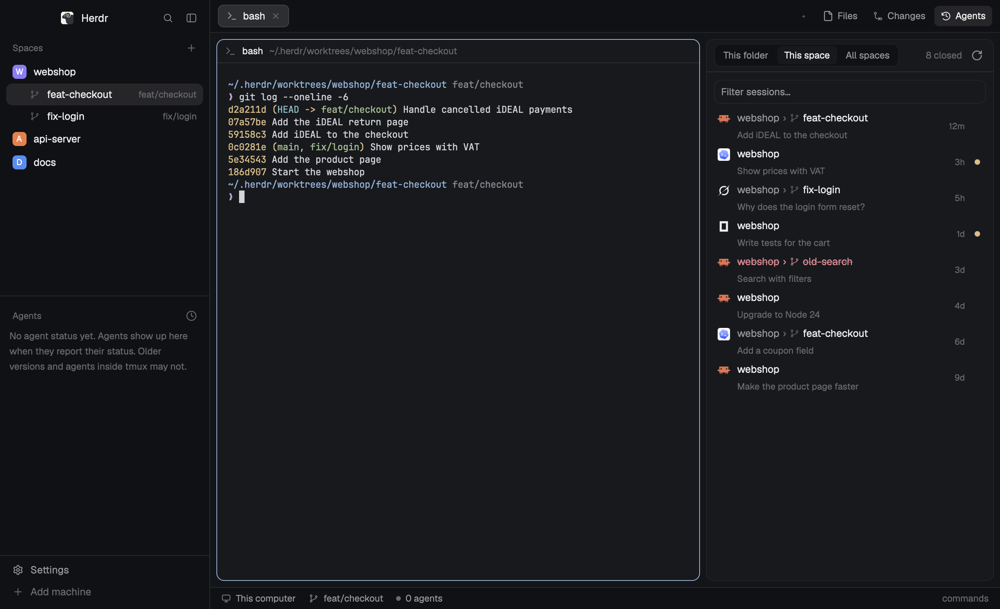

# Sessions panel for the Herdr desktop app

All your closed agent sessions in one list: Claude Code, Codex, Grok and OpenCode. See what you worked on and how it ended, then resume right where you left off.



> [!NOTE]
> This is a mod for the Herdr **desktop app** (`herdr-app`), not for Herdr in the terminal (`herdr`).

## What it does

- **Lists your closed sessions**, newest first: from this folder, this space (its repository with all its worktrees) or all spaces.
- **Opens a session** with a summary and its details, such as the branch, cost, models and pull requests.
- **Resumes a session** in a new tab, in its own folder and in the mode it started in.
- **Copies** the session ID, the resume command, the transcript path or the folder, with a right-click.

<p>
  
  
</p>

## Install

Ask an agent in the Herdr desktop app:

> Add the Herdr mod from https://github.com/inlet/herdr-sessions, with an "Agents" button in the tab bar that opens it in the side panel.

<details>
<summary>Or install it by hand</summary>

1. Copy the mod into Herdr and check it:

   ```sh
   git clone https://github.com/inlet/herdr-sessions
   cp -R herdr-sessions/mods/sessions-history ~/.config/herdr-app/mods/
   herdr-app check ~/.config/herdr-app/mods/sessions-history
   ```

2. Make your own copies of Herdr's layout and tab bar:

   ```sh
   herdr-app do layout.clone '{"name":"main","as":"my-layout"}'
   herdr-app do mod.clone '{"name":"tabs","as":"my-tabs"}'
   ```

3. In `~/.config/herdr-app/layouts/my-layout.json`, change the `tabs` block's content to `{ "mod": "my-tabs" }`, and add this block to the children of the `panel-body` stack:

   ```json
   { "id": "session-history-panel", "type": "block", "content": { "mod": "sessions-history" } }
   ```

4. In `~/.config/herdr-app/mods/my-tabs/main.js`, add the panel to the enabled panels, and give it a button after the Changes button:

   ```js
   const enabled = [...(shared("workspace.panels") ?? ["files", "changes"]), "session-history-panel"];
   ```

   ```js
   .child(panelButton("session-history-panel", "Agents", "mods/sessions-history/history.svg"))
   ```

5. Switch to your layout: `herdr-app do layout.switch '{"name":"my-layout"}'`.

To update, copy the new `mods/sessions-history` folder over the old one. To remove it, delete that folder and `~/.config/herdr-app/data/sessions-history`.

</details>

## Requirements

- The Herdr desktop app, on macOS or Linux. Tested with herdr-app 0.1.18.
- Python 3 and `git`.
- Claude Code (`claude`), logged in, for the summaries.

## Privacy

Everything stays on your computer, except the summaries. For a session without a recap of its own, the panel sends the conversation's text (without tool output) to Claude through your own `claude` program. That counts towards your Claude usage. It also happens in the background for the twenty newest sessions. Each summary is saved, so a session is only summarized again when it changes.

## License

[MIT](LICENSE). The icons are from [Lucide](https://lucide.dev) (ISC) and [Herdr](https://github.com/herdrdev/herdr-app) (Apache 2.0); see [ICONS-LICENSE.txt](mods/sessions-history/ICONS-LICENSE.txt).
